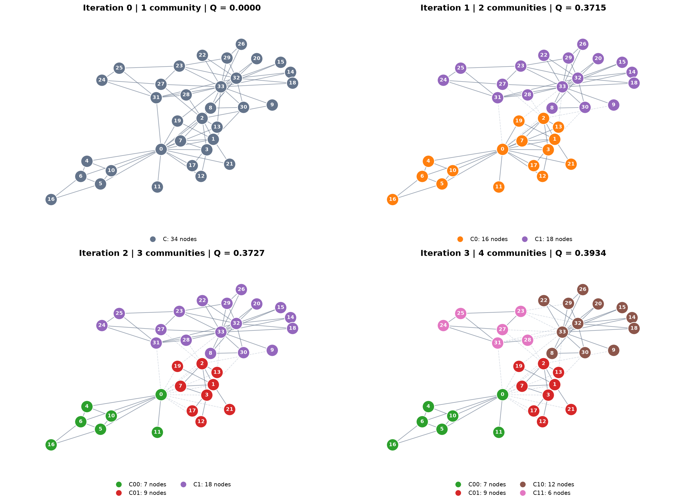

# DSC212: Modularity on the Karate Club Graph

**Student:** Shashwat Sangwan  
**Course:** DSC212, Graph Theory  
**Primary submission:** [DSC212_Karate_Club_Modularity.ipynb](DSC212_Karate_Club_Modularity.ipynb)

The notebook implements recursive spectral modularity partitioning from scratch with
NumPy, visualizes every accepted split, computes four NetworkX node metrics, plots
all 34 nodes across iterations, and discusses the actual results. It includes saved
outputs, method explanations, numerical checks, and conceptual exam study notes.
AI assistance was used, as permitted by the instructor's announcement.

## Results

- Dataset: 34 nodes, 78 edges; undirected and explicitly unweighted.
- Three accepted splits produce four communities of sizes **7, 9, 12, and 6**.
- Final original-graph modularity: **0.393409**.
- Every accepted gain is checked against the complete partition and independently
  validated with NetworkX's modularity score. No NetworkX community detector is used.
- One positive-eigenvalue proposal has negative actual gain and is correctly rejected.



## Reproduce

Use Python **3.12**. From a clone or downloaded copy of this repository:

```bash
python -m venv .venv
source .venv/bin/activate
python -m pip install -r requirements.txt
python -m nbconvert --to notebook --execute --inplace DSC212_Karate_Club_Modularity.ipynb
```

On Windows, activate with `.venv\Scripts\activate` instead. To use the interactive
notebook interface, also install it with `python -m pip install notebook`, then run:

```bash
python -m notebook DSC212_Karate_Club_Modularity.ipynb
```

Choose **Restart Kernel and Run All Cells**. No data downloads or edits are required.
Running the notebook regenerates the figure, CSV, and JSON assets under `artifacts/`.
The committed notebook already includes its rendered outputs for viewing on GitHub.

## Two important interpretation choices

### Recursive modularity

The handout's recursive section describes both an unadjusted block of the global
matrix and a matrix recomputed on an induced subgraph. To preserve the intended
global objective, the implementation uses Newman's adjusted community matrix:

$$
\widetilde B_C=B[C,C]-\operatorname{diag}(B[C,C]\mathbf 1),\qquad
\Delta Q=\frac{s^\top\widetilde B_Cs}{4m}.
$$

Original degrees and the original edge count remain fixed. A sign split is accepted
only if both children are nonempty and the actual modularity gain exceeds `1e-10`.
The notebook derives the correction and documents the discrepancy with the handout.
The method is a spectral heuristic without vertex-move fine-tuning; no global
optimality or exhaustive indivisibility claim is made.

### Metrics after a split

The handout asks for evolving metrics without defining a changed graph. The notebook
therefore records two clearly labeled scopes:

1. **Within-community metrics:** compute each node's degree centrality, normalized
   betweenness, corrected closeness, and clustering in its current induced community.
   These are the primary evolution plots; all nodes appear in every iteration.
2. **Full-graph control:** compute all four metrics on the unchanged original graph.
   These stay constant, demonstrating that recoloring alone cannot change centrality.

Local normalization depends on community size. A larger local score must not be
interpreted as an increase in original whole-network influence. The notebook gives
specific raw-degree versus normalized-degree examples and a disconnected-closeness
convention. These scope choices are explicit assumptions where the handout is ambiguous.

## Files

| Path | Contents |
|---|---|
| `DSC212_Karate_Club_Modularity.ipynb` | Self-contained, executed assignment |
| `requirements.txt` | Pinned direct dependencies used for execution |
| `artifacts/figures/` | Every graph snapshot, all-node metric plots, global control, modularity plot |
| `artifacts/tables/` | All node-iteration values, communities, split decisions, rankings, comparisons |
| `artifacts/partition_history.json` | Complete partition after every accepted split |
| `artifacts/split_attempts.json` | Accepted and rejected proposals with diagnostics |
| `artifacts/metric_history_*.json` | Metric dictionaries keyed by iteration and node |
| `artifacts/run_metadata.json` | Versions, conventions, and run summary |
| `artifacts/validation.json` | Numerical and coverage checks |

## References

- Newman, M. E. J. (2006). *Modularity and community structure in networks*.
  **PNAS 103**(23), 8577-8582. [doi:10.1073/pnas.0601602103](https://doi.org/10.1073/pnas.0601602103).
  [Author preprint](https://arxiv.org/abs/physics/0602124).
- Zachary, W. W. (1977). *An Information Flow Model for Conflict and Fission in Small
  Groups*. **Journal of Anthropological Research 33**(4), 452-473.
- Official NetworkX documentation is linked in the notebook beside the relevant
  dataset, modularity, and metric definitions.

## Course submission

Submit **https://github.com/shashwat25-dot/DSC-212** through the Google Sheet specified
in the instructor's announcement, together with your name and roll number. Uploading
the repository alone does not enter the course's submission Sheet. The announcement
sets the deadline to the subject's end-semester exam date.
